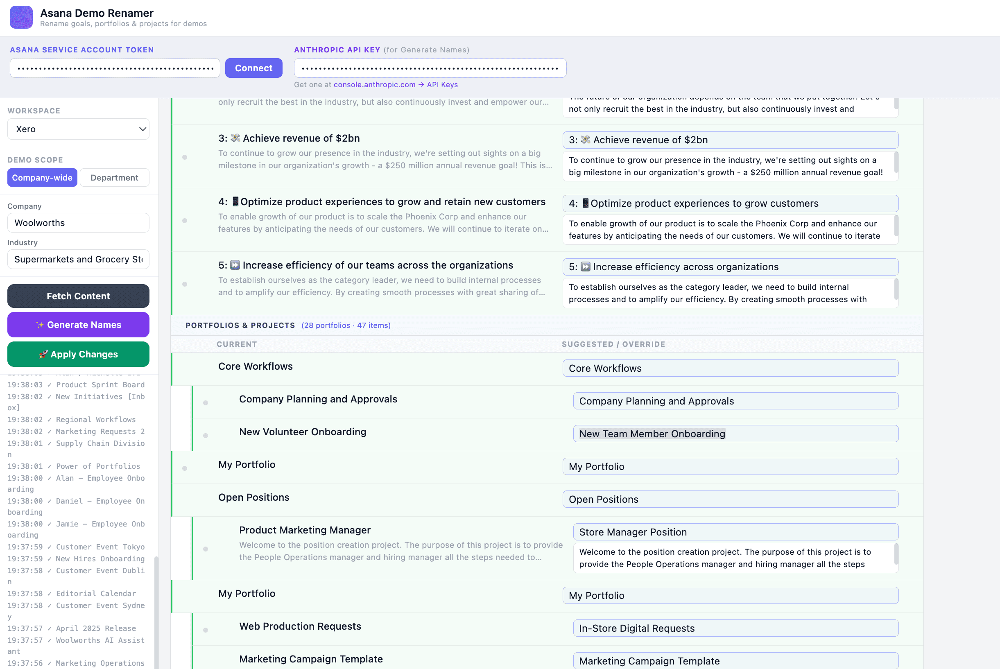

# Phoenix Demo Content Renamer

A little local app that allows you to quickly rename an entire* Phoenix environment for demos.

## ⚠️ Be aware; ⚠️
* It may destroy your Phoenix environment irrepairably (so maybe do it with a blank phpoenix before you do anything else, instead of in a fully populated or beloved environment)

## What it does;
* Renames Goals and any Projects and Portfolios (incl descriptions)
* Renames all Portfolios (if applicable) along with projects underneath)
* You can get it to rename everything for a "Company" (i.e. multiple departments like Phoenix) or a "Department" (should be more niche - Daniel has not tried the Department setting

## What it doesn't do
* It does not rename Tasks
* It does not do anything overly intelligent beyond giving the perception of a nice tailored environment for a customer

## You need;
* A Phoenix Environment
* A Service Account token from the Phoenix admin console (with full permissions)
* An Anthropic API key

## Installation (GitHub Pages, fully client-side)
1. Push `index.html`, `styles.css`, `app.js` and `.nojekyll` to a GitHub repo
2. Settings → Pages → deploy from the branch root
3. Open the published URL. No server needed: the browser calls Asana and Anthropic directly
   (Anthropic via the `anthropic-dangerous-direct-browser-access` header).
4. Your tokens live only in page memory and are never saved. They are sent only to Asana and Anthropic.
5. To edit the UI, change `src/app.jsx` and rebuild:
   `npx esbuild src/app.jsx --loader:.jsx=jsx --target=es2020 --outfile=app.js`

(Legacy: `asana-demo-renamer-server.js` + `asana-demo-renamer.html` still work locally via `node asana-demo-renamer-server.js`.)

## Using the app;
1. Open the GitHub Pages URL (or http://localhost:3000 for the legacy server)
2. Go to settings if it's not already opened and enter Service Account token and Anthropic API key
3. Click connect
4. Click fetch details
5. Click "Generate names"
6. Make any changes you want
7. Click "Apply changes"

## Things you might still want to do
1. Check your content and memorise your projects
2. Change org name and logo
3. Change user name and profile pic if needed

## Tech details
* It uses Claude Haiki to save money
* You have to check and be responsible for your credit use, author takes zero responsibility but when he ran it cost <$1 to populate a phoenix
* It runs with 3 concurrent threads to speed things up and also avoid rate limiting of the Asana API

